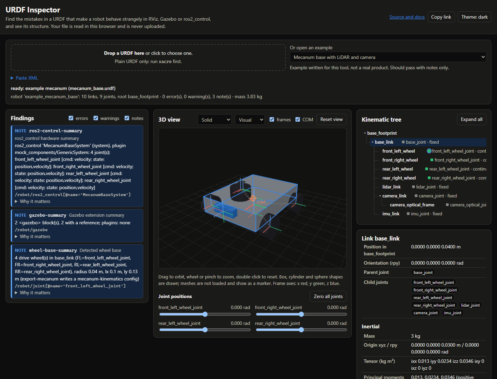
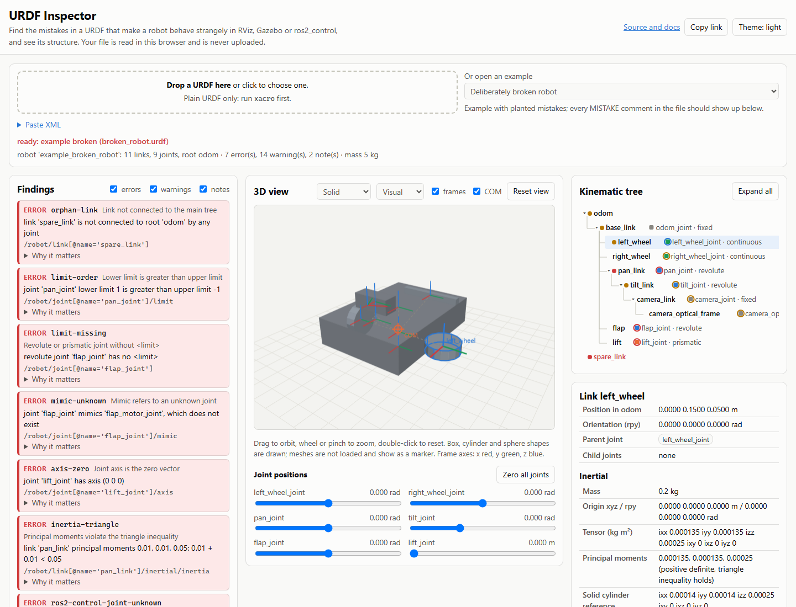
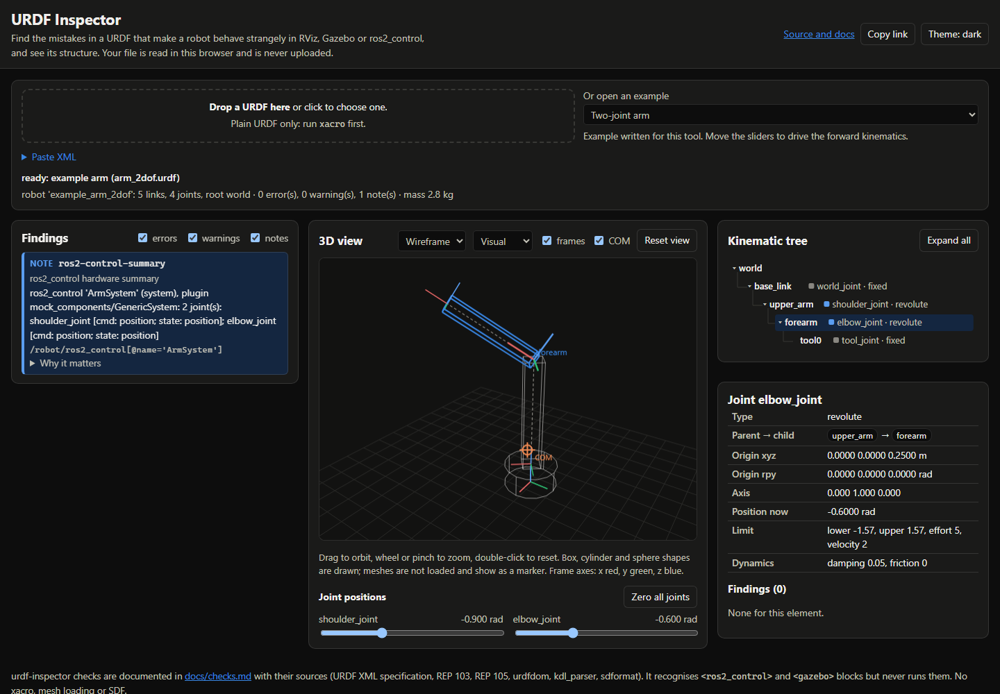
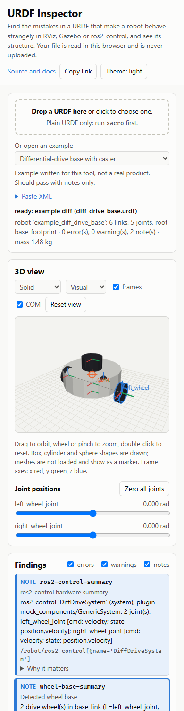

# urdf-inspector

[](https://github.com/projectbin07-stack/urdf-inspector/actions/workflows/ci.yml)
[](LICENSE)

Load a URDF in the browser or on the command line, find the mistakes that
make robots behave strangely in RViz, Gazebo or ros2_control, and see the
robot's structure.

**Live demo:** <https://projectbin07-stack.github.io/urdf-inspector/>
(the file you drop or paste is read in your browser and never uploaded)

> **Validation status:** the checks are written from the URDF specification,
> REP 103/105 and the source of urdfdom, kdl_parser and sdformat (all cited in
> [docs/checks.md](docs/checks.md)), and are tested on the bundled example
> models and minimal fixtures. Beyond that, the tool has been run on one
> public model only (see [Tested on](#tested-on)). It has not been compared
> with RViz or Gazebo on a large set of real robot descriptions.



## Why it exists

A URDF that loads is not necessarily a URDF that works. A wheel cylinder
without `rpy="1.5708 0 0"` lies flat; an inertia of `1 1 1` copied from a
tutorial makes a 200 g link behave like a flywheel; a link without
`<inertial>` disappears from Gazebo together with everything attached to
it; a camera frame without the optical rotation projects detections
sideways; one wheel axis flipped makes the robot spin when told to drive
straight. None of these stop `robot_state_publisher`, and most only show up
as odd behaviour much later. `check_urdf` validates the syntax; this tool
looks for the mistakes in between, explains each one with the element path
and the reason, and shows the kinematic tree and a 3D view so you can see
what the file describes.

## Features

- **Parser** for links, joints (revolute, continuous, prismatic, fixed,
  floating, planar), origins, axes, limits, dynamics, mimic, inertials,
  visual and collision geometry (box, cylinder, sphere, mesh reference),
  materials, `<transmission>`, and `<ros2_control>` / `<gazebo>` blocks
  (recognised and summarised, never executed). Written from the
  specification with no dependencies: `DOMParser` in the browser, a small XML
  reader in Node.
- **Unexpanded xacro is detected** (`xacro:` elements, `${...}`, `$(...)`)
  and reported with every location, asking you to run xacro first.
- **72 checks** with severity, element path (and source line in the CLI) and
  an explanation: tree structure, REP 105 frame names, joint axes and limits,
  mimic, inertia validity (positive definiteness, triangle inequality,
  comparison with the solid-body inertia of the link's shape), links Gazebo
  drops, unit mistakes, collision geometry, mesh references, ros2_control
  and Gazebo names, and wheel consistency for differential and mecanum bases.
- **Forward kinematics** for any joint configuration (mimic joints follow
  their source), per-link poses, total mass and centre of mass.
- **mecanum-kinematics export**: measured wheel radius, `lx` and `ly` as a
  config file for [mecanum-kinematics](https://github.com/projectbin07-stack/mecanum-kinematics).
- **Browser app**: drop a file or paste XML, findings linked to the
  elements, collapsible kinematic tree (SVG), 3D wireframe or solid view of
  the primitive shapes drawn with its own projection code (orbit with mouse
  or touch, frame axes, centre-of-mass marker, click a frame to select it),
  joint sliders that drive the forward kinematics live, a details panel for
  each link and joint, shareable links, light and dark themes, phone layout.
  No external assets, CDNs or network calls.
- **CLI** with CI-friendly exit codes and JSON output.

## Screenshots

These are captures of the live demo in headless Microsoft Edge (the phone view
in a 390 px wide frame).

|                                                                                                               |                                                                                                                               |
| ------------------------------------------------------------------------------------------------------------- | ----------------------------------------------------------------------------------------------------------------------------- |
|              |                          |
| The deliberately broken example: 7 errors and 14 warnings. The unrotated left wheel lies flat in the 3D view. | The two-joint arm in wireframe at shoulder -0.9 rad and elbow -0.6 rad (set by the sliders or the link), elbow joint details. |



## Install

The browser app needs nothing: open the [live demo](https://projectbin07-stack.github.io/urdf-inspector/).

The CLI needs Node.js 22 or newer and has no runtime dependencies. It is not
published on npm; run it from a clone:

```bash
git clone https://github.com/projectbin07-stack/urdf-inspector.git
cd urdf-inspector
node bin/urdf-inspector.js check path/to/robot.urdf
# optional: put `urdf-inspector` on your PATH
npm link
```

The input must be plain URDF. For a xacro file:

```bash
ros2 run xacro xacro my_robot.urdf.xacro > /tmp/my_robot.urdf
node bin/urdf-inspector.js check /tmp/my_robot.urdf
```

## Quick start (command line)

All output below is copied from real runs on the bundled examples.

```console
$ urdf-inspector check examples/mecanum_base.urdf
examples/mecanum_base.urdf
  robot 'example_mecanum_base': 10 links, 9 joints (4 continuous, 5 fixed), root base_footprint
  mass 3.83 kg, centre of mass (0.0061, 0.0000, 0.0678) m in base_footprint
  0 error(s), 0 warning(s), 3 note(s)

INFO  ros2-control-summary  (line 201)
      ros2_control 'MecanumBaseSystem' (system), plugin mock_components/GenericSystem: 4 joint(s): front_left_wheel_joint [cmd: velocity; state: position,velocity]; front_right_wheel_joint [cmd: velocity; state: position,velocity]; rear_left_wheel_joint [cmd: velocity; state: position,velocity]; rear_right_wheel_joint [cmd: velocity; state: position,velocity]
      at /robot/ros2_control[@name='MecanumBaseSystem']
INFO  gazebo-summary
      2 <gazebo> block(s), 2 with a reference; plugins: none
      at /robot/gazebo
INFO  wheel-base-summary  (line 44)
      4 drive wheel(s) in base_link (FL=front_left_wheel_joint, FR=front_right_wheel_joint, RL=rear_left_wheel_joint, RR=rear_right_wheel_joint), radius 0.04 m, lx 0.1 m, ly 0.13 m (export-mecanum writes a mecanum-kinematics config)
      at /robot/joint[@name='front_left_wheel_joint']
$ echo $?
0
```

The deliberately broken example (every mistake is marked `MISTAKE` in
[the file](examples/broken_robot.urdf)):

```console
$ urdf-inspector check examples/broken_robot.urdf
examples/broken_robot.urdf
  robot 'example_broken_robot': 11 links, 9 joints (2 continuous, 3 fixed, 1 prismatic, 3 revolute), root odom
  mass 5 kg, centre of mass (0.0024, 0.0000, 0.0592) m in odom
  7 error(s), 14 warning(s), 2 note(s)

ERROR orphan-link  (line 160)
      link 'spare_link' is not connected to root 'odom' by any joint
      at /robot/link[@name='spare_link']
ERROR limit-order  (line 78)
      joint 'pan_joint' lower limit 1 is greater than upper limit -1
      at /robot/joint[@name='pan_joint']/limit
ERROR limit-missing  (line 129)
      revolute joint 'flap_joint' has no <limit>
      at /robot/joint[@name='flap_joint']
ERROR mimic-unknown  (line 129)
      joint 'flap_joint' mimics 'flap_motor_joint', which does not exist
      at /robot/joint[@name='flap_joint']/mimic
ERROR axis-zero  (line 145)
      joint 'lift_joint' has axis (0 0 0)
      at /robot/joint[@name='lift_joint']/axis
ERROR inertia-triangle  (line 86)
      link 'pan_link' principal moments 0.01, 0.01, 0.05: 0.01 + 0.01 < 0.05
      at /robot/link[@name='pan_link']/inertial/inertia
ERROR ros2-control-joint-unknown  (line 171)
      <ros2_control name="BrokenSystem"> joint 'right_wheel_jiont' is not a URDF joint
      at /robot/ros2_control[@name='BrokenSystem']/joint[@name='right_wheel_jiont']
WARN  odom-in-urdf  (line 12)
      link 'odom' is a REP 105 world frame and should be published by odometry, not by the URDF
      at /robot/link[@name='odom']
WARN  optical-frame  (line 120)
      'camera_optical_frame' axes relative to 'camera_link' are not z forward, x right, y down; the usual joint rpy is "-1.5708 0 -1.5708"
      at /robot/joint[@name='camera_optical_joint']/origin
WARN  continuous-limits  (line 55)
      continuous joint 'right_wheel_joint' has lower/upper limits, which are ignored
      at /robot/joint[@name='right_wheel_joint']/limit
WARN  limit-degrees  (line 96)
      joint 'tilt_joint' limit -45, 90 rad is more than a full turn; degrees?
      at /robot/joint[@name='tilt_joint']/limit
WARN  limit-zero  (line 96)
      joint 'tilt_joint' effort limit is 0
      at /robot/joint[@name='tilt_joint']/limit
WARN  inertia-implausible  (line 20)
      link 'base_link' principal moments 1, 1, 1 are up to 40.5405x larger than a solid box of 4 kg (0.0246667, 0.0453333, 0.0657333); reference ixx=0.0246667 ixy=0 ixz=0 iyy=0.0453333 iyz=0 izz=0.0657333
      at /robot/link[@name='base_link']/inertial/inertia
WARN  inertial-missing  (line 105)
      link 'tilt_link' is moved by revolute joint 'tilt_joint' but has no <inertial>
      at /robot/link[@name='tilt_link']
WARN  gazebo-dropped  (line 105)
      link 'tilt_link' has no mass behind revolute joint 'tilt_joint', nor do its fixed children; Gazebo drops it with 1 child joint(s) and 2 descendant link(s)
      at /robot/link[@name='tilt_link']
WARN  mesh-scheme  (line 86)
      link 'pan_link' visual mesh 'https://example.com/meshes/pan.stl' is fetched over the network at load time, if the loader supports it at all
      at /robot/link[@name='pan_link']/visual[1]/geometry/mesh
WARN  mesh-scheme  (line 86)
      link 'pan_link' collision mesh 'https://example.com/meshes/pan.stl' is fetched over the network at load time, if the loader supports it at all
      at /robot/link[@name='pan_link']/collision[1]/geometry/mesh
WARN  collision-missing  (line 105)
      link 'tilt_link' has 1 visual(s) and no collision
      at /robot/link[@name='tilt_link']
WARN  rpy-degrees  (line 114)
      joint 'camera_joint' rpy (0 0 90) has angles above 2*pi rad; degrees?
      at /robot/joint[@name='camera_joint']/origin
WARN  wheel-cylinder-axis  (line 44)
      wheel 'left_wheel' cylinder lies along (0 0 1) but the joint spins about (0 1 0); the wheel is not upright
      at /robot/link[@name='left_wheel']/collision[1]/origin
WARN  wheel-direction-mixed  (line 55)
      wheel axes 'left_wheel_joint' point to +y and 'right_wheel_joint' to -y; a positive velocity drives them in opposite directions
      at /robot/joint[@name='right_wheel_joint']/axis
INFO  ros2-control-summary  (line 163)
      ros2_control 'BrokenSystem' (system), plugin mock_components/GenericSystem: 2 joint(s): left_wheel_joint [cmd: velocity; state: velocity]; right_wheel_jiont [cmd: velocity; state: velocity]
      at /robot/ros2_control[@name='BrokenSystem']
INFO  wheel-base-summary  (line 37)
      2 drive wheel(s) in base_link (L=left_wheel_joint, R=right_wheel_joint), radius 0.05 m, wheel separation 0.3 m
      at /robot/joint[@name='left_wheel_joint']
$ echo $?
2
```

The kinematic tree:

```console
$ urdf-inspector tree examples/mecanum_base.urdf
base_footprint
`-- base_joint (fixed) -> base_link
    |-- front_left_wheel_joint (continuous, axis 0 1 0) -> front_left_wheel
    |-- front_right_wheel_joint (continuous, axis 0 1 0) -> front_right_wheel
    |-- rear_left_wheel_joint (continuous, axis 0 1 0) -> rear_left_wheel
    |-- rear_right_wheel_joint (continuous, axis 0 1 0) -> rear_right_wheel
    |-- lidar_joint (fixed) -> lidar_link
    |-- camera_joint (fixed) -> camera_link
    |   `-- camera_optical_joint (fixed) -> camera_optical_frame
    `-- imu_joint (fixed) -> imu_link
```

Forward kinematics (radians for revolute joints, metres for prismatic). For
this arm the tool point is at `x = 0.2 cos(b) cos(a)`, `y = 0.2 cos(b)
sin(a)`, `z = 0.30 - 0.2 sin(b)`; with `a = 0.5`, `b = 0.3` that is
`(0.1677, 0.0916, 0.2409)`:

```console
$ urdf-inspector fk examples/arm_2dof.urdf --joint shoulder_joint=0.5 --joint elbow_joint=0.3
joint positions: shoulder_joint=0.5, elbow_joint=0.3
poses in world (m, rad; rpy as in URDF)
link               x         y         z       roll    pitch      yaw
world         0.0000    0.0000    0.0000     0.0000   0.0000   0.0000
base_link     0.0000    0.0000    0.0000     0.0000   0.0000   0.0000
upper_arm     0.0000    0.0000    0.0500     0.0000   0.0000   0.5000
forearm       0.0000    0.0000    0.3000     0.0000   0.3000   0.5000
tool0         0.1677    0.0916    0.2409     0.0000   0.3000   0.5000
mass 2.8 kg, centre of mass (0.0090, 0.0049, 0.0781)
```

A mecanum-kinematics config measured from the URDF:

```console
$ urdf-inspector export-mecanum examples/mecanum_base.urdf
# Generated by urdf-inspector from the URDF geometry. Check every value
# against the real robot before using it for odometry.
name = "example_mecanum_base"
description = "Measured from URDF 'example_mecanum_base' (frame base_link)"

wheel_radius = 0.04      # m, mean of the wheel cylinders
half_length = 0.1       # m, lx: wheel centroid to wheel centre along x
half_width = 0.13        # m, ly: wheel centroid to wheel centre along y
roller_angle_deg = 45.0   # not in the URDF; 45 for ordinary mecanum wheels
# ticks_per_rev and gear_ratio are not in the URDF; add them for encoder odometry.
max_wheel_speed = 20   # rad/s, smallest wheel <limit velocity>
wheel_order = ["FL", "FR", "RL", "RR"]

# URDF joints in that order:
#   FL: front_left_wheel_joint (+y axis)
#   FR: front_right_wheel_joint (+y axis)
#   RL: rear_left_wheel_joint (+y axis)
#   RR: rear_right_wheel_joint (+y axis)
```

That file was loaded by mecanum-kinematics' `RobotConfig.from_toml` and used
for `mecanum ik --vx 0.2`, which gave 5.0 rad/s on all four wheels
(0.2 m/s / 0.04 m), on the author's machine. That check is not part of CI.

### Usage

```text
urdf-inspector check <robot.urdf> [--json] [--strict]
urdf-inspector tree <robot.urdf>
urdf-inspector fk <robot.urdf> [--joint name=value ...] [--json]
urdf-inspector export-mecanum <robot.urdf> [--out config.toml]
urdf-inspector checks            list every check with its severity
urdf-inspector --help | --version
```

Exit codes, for CI: **0** no errors (and no warnings with `--strict`),
**1** warnings with `--strict`, **2** errors in the model (or nothing to
export), **3** usage or file error.

`check --json` prints:

```json
{
  "tool": "urdf-inspector",
  "version": "0.1.1",
  "file": "examples/arm_2dof.urdf",
  "summary": {
    "name": "example_arm_2dof",
    "links": 5,
    "joints": 4,
    "jointTypes": { "fixed": 2, "revolute": 2 },
    "root": "world",
    "totalMass": 2.8,
    "com": [0.0107143, 0, 0.08125],
    "errors": 0,
    "warnings": 0,
    "infos": 1
  },
  "findings": [
    {
      "id": "ros2-control-summary",
      "severity": "info",
      "message": "ros2_control 'ArmSystem' (system), plugin mock_components/GenericSystem: 2 joint(s): shoulder_joint [cmd: position; state: position]; elbow_joint [cmd: position; state: position]",
      "path": "/robot/ros2_control[@name='ArmSystem']",
      "target": { "kind": "robot", "name": "example_arm_2dof" },
      "line": 102
    }
  ]
}
```

(Reformatted: the CLI prints one value per line.) Some findings carry a
`data` object, for example the reference inertia tensor for
`inertia-implausible`. The output is byte-identical for the same input.

A GitHub Actions step for a ROS package:

```yaml
- name: Check the robot description
  run: |
    xacro urdf/robot.urdf.xacro > robot.urdf
    node urdf-inspector/bin/urdf-inspector.js check robot.urdf --strict
```

## Checks

Every check, its threshold and its source is described in
[docs/checks.md](docs/checks.md). In short:

**Input**

| Check                                                      | Severity | Why it matters                                                                                                                                                                                                                            |
| ---------------------------------------------------------- | -------- | ----------------------------------------------------------------------------------------------------------------------------------------------------------------------------------------------------------------------------------------- |
| `xml-syntax` XML is not well formed                        | error    | Every URDF consumer starts with an XML parser; a syntax error stops robot_state_publisher, RViz and Gazebo before they read a single link.                                                                                                |
| `not-urdf` Root element is not <robot>                     | error    | urdfdom looks for a <robot> root element and rejects anything else, for example an SDF <sdf> file or a launch file.                                                                                                                       |
| `xacro` Unexpanded xacro                                   | error    | xacro: elements, ${...} expressions and $(...) substitutions are only meaningful to the xacro preprocessor. Plain URDF parsers see literal text such as '${wheel_radius}', which is not a number. Run xacro first and inspect its output. |
| `version-unsupported` Unsupported URDF version attribute   | warning  | urdfdom accepts version 1.0 to 1.2 on <robot>; other values make it refuse the file.                                                                                                                                                      |
| `missing-attribute` Required attribute or element missing  | error    | urdfdom rejects links, joints, inertials and geometries that lack required attributes (names, parent/child links, mass value, all six inertia terms, radius/length, mesh filename).                                                       |
| `bad-number` Value is not a number or has the wrong count  | error    | Vectors such as xyz, rpy, axis and size need exactly three numbers; a typo or a unit suffix makes urdfdom fail to load the model.                                                                                                         |
| `unknown-joint-type` Joint type missing or unknown         | error    | The URDF joint types are revolute, continuous, prismatic, fixed, floating and planar. Anything else is rejected by urdfdom.                                                                                                               |
| `unknown-geometry` Geometry this tool does not understand  | warning  | URDF 1.0 geometry is box, cylinder, sphere or mesh. Other shapes (for example capsule, only in recent urdfdom) are not read by every consumer; this tool ignores them for mass and inertia checks.                                        |
| `missing-geometry` Visual or collision without geometry    | error    | urdfdom requires a <geometry> with exactly one shape inside every <visual> and <collision> and rejects the link otherwise.                                                                                                                |
| `unknown-element` Element not part of URDF                 | info     | Unknown top-level elements are ignored by urdfdom. This is often harmless (vendor extensions) but can also be a misspelt <joint> or <link> that silently disappears.                                                                      |
| `undefined-material` Material referenced but never defined | warning  | A <material name='x'/> without a colour must refer to a top-level material of that name. urdfdom logs an error for an undefined one and RViz falls back to a default colour.                                                              |
| `duplicate-material` Top-level material defined twice      | error    | urdfdom requires top-level material names to be unique and fails to load the model otherwise.                                                                                                                                             |

**Tree structure**

| Check                                                       | Severity | Why it matters                                                                                                                                  |
| ----------------------------------------------------------- | -------- | ----------------------------------------------------------------------------------------------------------------------------------------------- |
| `no-links` Robot has no links                               | error    | A URDF needs at least one link; urdfdom fails with 'No link elements found'.                                                                    |
| `duplicate-link` Two links with the same name               | error    | Link names are TF frame names and must be unique; urdfdom refuses the model.                                                                    |
| `duplicate-joint` Two joints with the same name             | error    | Joint names key /joint_states, ros2_control and MoveIt; urdfdom refuses duplicates.                                                             |
| `missing-link` Joint refers to a link that does not exist   | error    | A parent or child name that matches no link (often a typo or a renamed link) makes tree construction fail.                                      |
| `self-joint` Joint connects a link to itself                | error    | Parent and child must differ; a self-loop is a cycle of length one.                                                                             |
| `multiple-parents` Link is the child of more than one joint | error    | URDF describes a tree: every link except the root has exactly one parent joint. Closed chains cannot be expressed in URDF.                      |
| `cycle` Joints form a cycle                                 | error    | A cycle leaves no root link and makes forward kinematics undefined; urdfdom fails to find the root.                                             |
| `orphan-link` Link not connected to the main tree           | error    | urdfdom requires exactly one root. A second root is usually a link whose joint was forgotten or misnamed, and it would have no transform in TF. |

**Frames (REP 103, REP 105)**

| Check                                                                          | Severity | Why it matters                                                                                                                                                                                                                                             |
| ------------------------------------------------------------------------------ | -------- | ---------------------------------------------------------------------------------------------------------------------------------------------------------------------------------------------------------------------------------------------------------- |
| `no-base-link` No link called base_link                                        | warning  | REP 105 names the frame rigidly attached to a mobile base 'base_link', and navigation, localisation and many drivers default to it. Arms by ROS-Industrial convention use it too.                                                                          |
| `footprint-relation` base_footprint not rigidly attached to base_link          | warning  | base_footprint is the base projected onto the floor. It must be connected to base_link by fixed joints only, with no roll or pitch between them, or the 2D pose used by navigation tilts and moves with the joints.                                        |
| `footprint-height` base_footprint is not at wheel contact height               | warning  | base_footprint should lie on the floor plane. When wheels are detected, the lowest wheel contact point should be at z = 0 in base_footprint; otherwise costmaps and the robot model in RViz float or sink.                                                 |
| `odom-in-urdf` World frame (odom, map, earth) defined as a link                | warning  | REP 105 frames odom, map and earth are published by odometry and localisation nodes. A link with that name in the URDF makes robot_state_publisher publish a second, fixed transform into the same tree.                                                   |
| `root-inertia` Root link has an inertial block                                 | warning  | kdl_parser (used by robot_state_publisher and many solvers) warns that KDL does not support inertia on the root link and ignores it. Add a massless root such as base_footprint with a fixed joint to the massive base.                                    |
| `kdl-unsupported-joint` Floating or planar joint                               | warning  | kdl_parser converts floating and planar joints into fixed joints, so robot_state_publisher will never move the child. These joints are usually better published as a TF transform by another node.                                                         |
| `optical-frame` Optical frame not in the z-forward, x-right, y-down convention | warning  | REP 103 defines frames with an '_optical' suffix as z forward, x right, y down relative to the body (x forward, y left, z up). Camera drivers publish images in the optical frame; a wrong rotation projects points and detections in the wrong direction. |
| `camera-no-optical` Camera link without an optical frame                       | info     | Image and point cloud messages should carry an '_optical' frame (REP 103). Without one, a driver either uses the body-convention camera link (wrong axes) or needs a static transform from elsewhere.                                                      |

**Joints**

| Check                                                           | Severity | Why it matters                                                                                                                                                                         |
| --------------------------------------------------------------- | -------- | -------------------------------------------------------------------------------------------------------------------------------------------------------------------------------------- |
| `axis-zero` Joint axis is the zero vector                       | error    | A zero axis gives a rotation or translation about nothing; the joint never moves and some solvers divide by its length.                                                                |
| `axis-not-unit` Joint axis is not unit length                   | warning  | The URDF specification asks for a normalised axis. Consumers differ in whether they normalise it, so a prismatic joint can move further than commanded in one tool and not in another. |
| `axis-ignored` Axis on a fixed or floating joint                | info     | fixed and floating joints have no axis; the value is ignored, which may mean the joint type is not the one intended.                                                                   |
| `limit-missing` Revolute or prismatic joint without <limit>     | error    | urdfdom rejects revolute and prismatic joints without limits ('does not specify limits').                                                                                              |
| `limit-attr-missing` <limit> without effort or velocity         | error    | Before URDF 1.2, effort and velocity are required attributes of <limit>; urdfdom refuses the joint without them.                                                                       |
| `limit-order` Lower limit is greater than upper limit           | error    | No position satisfies the limits. Controllers clamp every command to an empty range and MoveIt cannot sample a valid state.                                                            |
| `limit-equal` Lower and upper limits are equal                  | warning  | A movable joint that cannot move. Often a missing lower or upper attribute (both default to 0).                                                                                        |
| `limit-zero` Effort or velocity limit is zero                   | warning  | Controllers and simulators that enforce URDF limits clamp commands to zero, so the joint stays still without an obvious error.                                                         |
| `limit-negative` Negative effort or velocity limit              | error    | Limits are magnitudes. urdfdom rejects negative values from URDF 1.2 on, and older parsers produce undefined clamping.                                                                 |
| `limit-degrees` Revolute limit looks like degrees               | warning  | REP 103 and URDF use radians. A limit of 90 means about 14 turns, not a quarter turn.                                                                                                  |
| `continuous-limits` Continuous joint with lower/upper limits    | warning  | continuous joints have no position limits, so lower and upper are ignored. If the range matters, the joint should be revolute.                                                         |
| `full-range-revolute` Revolute range of a full turn or more     | info     | A revolute joint spanning 2*pi or more behaves like a continuous joint but planners treat it as bounded and may take the long way round.                                               |
| `mimic-unknown` Mimic refers to an unknown joint                | error    | The mimicked joint must exist; robot_state_publisher and simulators cannot compute the mimic joint's position otherwise.                                                               |
| `mimic-self` Joint mimics itself                                | error    | A self-referencing mimic has no defined position.                                                                                                                                      |
| `mimic-chain` Mimic of a mimic joint, or mimic of a fixed joint | warning  | Chained mimics and mimics of fixed joints are not resolved by every consumer; point every mimic joint at an actuated joint.                                                            |
| `mimic-zero` Mimic multiplier is zero                           | warning  | With multiplier 0 the joint never follows its source, which is almost always a typo.                                                                                                   |
| `dynamics-negative` Negative damping or friction                | error    | Negative damping injects energy; simulators that use the value become unstable.                                                                                                        |

**Mass and inertia**

| Check                                                                         | Severity | Why it matters                                                                                                                                                                                                                                                                                                                                                                        |
| ----------------------------------------------------------------------------- | -------- | ------------------------------------------------------------------------------------------------------------------------------------------------------------------------------------------------------------------------------------------------------------------------------------------------------------------------------------------------------------------------------------- |
| `inertial-missing` Link moved by a joint has no <inertial>                    | warning  | Dynamics, simulation and gravity compensation need a mass and inertia for every link that a non-fixed joint moves.                                                                                                                                                                                                                                                                    |
| `mass-nonpositive` Mass is zero or negative                                   | error    | Physical bodies have positive mass. Gazebo treats a link with mass <= 0 like one without <inertial>.                                                                                                                                                                                                                                                                                  |
| `inertia-not-pd` Inertia tensor is not positive definite                      | error    | A physical rotational inertia has three positive principal moments. A tensor with a zero or negative eigenvalue makes physics engines produce infinite or negative angular acceleration.                                                                                                                                                                                              |
| `inertia-triangle` Principal moments violate the triangle inequality          | error    | For any real mass distribution each principal moment is at most the sum of the other two (I1 + I2 >= I3). A tensor that breaks this cannot come from any body, even if it is positive definite.                                                                                                                                                                                       |
| `inertia-implausible` Inertia far from the value implied by mass and geometry | warning  | For a link with a single primitive shape the solid-body inertia is known. Principal moments ten times larger or smaller than that usually mean placeholder values (all 1.0), a unit error, or the wrong formula, and make the link spin too easily or too sluggishly in simulation.                                                                                                   |
| `inertia-axes` Inertia not rotated with the geometry                          | warning  | The principal moments match the single primitive shape but a principal axis does not, by more than 10 degrees. The classic case is a wheel cylinder rotated by rpy in `<visual>`/`<collision>` while `<inertial>` keeps the unrotated tensor, so the simulated wheel resists spinning about the wrong axis. Degenerate axes (sphere, a cylinder about its own axis) are not compared. |
| `density-implausible` Mass implies an implausible density                     | warning  | Mass divided by the volume of a single primitive shape outside 10 to 25000 kg/m^3 usually means grams instead of kilograms or a geometry in millimetres.                                                                                                                                                                                                                              |
| `gazebo-dropped` Massless link that Gazebo drops with its children            | warning  | The URDF to SDF conversion removes a link with no <inertial> or mass <= 0 unless fixed-joint lumping merges it into a massive parent, and it drops the link's child joints and links with it ('not modeled in sdf').                                                                                                                                                                  |

**Units**

| Check                                                    | Severity | Why it matters                                                                                                                         |
| -------------------------------------------------------- | -------- | -------------------------------------------------------------------------------------------------------------------------------------- |
| `units-mm` Lengths that look like millimetres            | warning  | REP 103 specifies metres. A 300 m wheel base or a 50 m wheel radius is a CAD export in millimetres; the model is 1000 times too large. |
| `rpy-degrees` Roll, pitch or yaw that looks like degrees | warning  | URDF angles are radians. Values above 2*pi (for example 90) are almost always degrees.                                                 |

**Geometry and meshes**

| Check                                                                        | Severity | Why it matters                                                                                                                                                                                                                                                                                                                          |
| ---------------------------------------------------------------------------- | -------- | --------------------------------------------------------------------------------------------------------------------------------------------------------------------------------------------------------------------------------------------------------------------------------------------------------------------------------------- |
| `geometry-nonpositive` Box, cylinder or sphere with a non-positive dimension | error    | Zero or negative sizes create degenerate collision shapes that physics engines reject or treat as points.                                                                                                                                                                                                                               |
| `collision-missing` Visual geometry without collision geometry               | warning  | Gazebo and MoveIt only use <collision>. A link that is visible but has no collision passes through the floor and through obstacles in planning.                                                                                                                                                                                         |
| `mesh-scheme` Mesh filename that will not resolve everywhere                 | warning  | package:// and file:// are the URI forms that both RViz and Gazebo with the ROS integration resolve. Relative paths depend on the working directory of whichever process loads the model, http(s) needs network access at load time and is not supported everywhere, and model:// is a Gazebo convention that RViz does not understand. |
| `mesh-format` Mesh format not commonly supported                             | warning  | RViz and Gazebo load STL, COLLADA (.dae) and OBJ reliably; other formats may load in one tool and not in the other.                                                                                                                                                                                                                     |
| `mesh-scale` Mesh scale zero or negative                                     | error    | A zero scale collapses the mesh. A negative scale mirrors it and flips its normals, which breaks lighting and can turn collision meshes inside out.                                                                                                                                                                                     |

**ros2_control, Gazebo, transmissions**

| Check                                                                                | Severity | Why it matters                                                                                                                            |
| ------------------------------------------------------------------------------------ | -------- | ----------------------------------------------------------------------------------------------------------------------------------------- |
| `ros2-control-joint-unknown` <ros2_control> names a joint that is not in the URDF    | error    | The controller manager matches hardware joints to URDF joints by name; an unknown name makes the hardware component fail to configure.    |
| `ros2-control-no-interface` <ros2_control> joint without command or state interfaces | warning  | A joint with no state_interface publishes nothing to /joint_states, and one with no command_interface cannot be driven by any controller. |
| `ros2-control-summary` ros2_control hardware summary                                 | info     | Lists the hardware plugin, joints and interfaces so they can be compared with the controller configuration.                               |
| `gazebo-reference-unknown` <gazebo reference> to an unknown link or joint            | warning  | Gazebo extensions are attached by name; a wrong reference silently drops friction, material or sensor settings.                           |
| `gazebo-summary` Gazebo extension summary                                            | info     | Lists Gazebo plugins and per-link extensions so they can be reviewed. They are recognised, not executed.                                  |
| `transmission-joint-unknown` <transmission> names a joint that is not in the URDF    | warning  | Transmission loaders match joints by name; an unknown one is skipped or fails to load.                                                    |

**Wheels**

| Check                                                                | Severity | Why it matters                                                                                                                                                                                      |
| -------------------------------------------------------------------- | -------- | --------------------------------------------------------------------------------------------------------------------------------------------------------------------------------------------------- |
| `wheel-axis` Wheel joint axis is not lateral                         | warning  | For a differential or mecanum base each wheel must spin about the base's y axis (REP 103: x forward, y left). Any other axis drives the robot sideways or not at all in simulation.                 |
| `wheel-cylinder-axis` Wheel cylinder not aligned with the joint axis | warning  | URDF cylinders are along their local z axis. Without rpy='1.5708 0 0' (or similar) the wheel lies flat, collides with the floor on its face and rolls on nothing.                                   |
| `wheel-direction-mixed` Wheel axes point in opposite directions      | warning  | diff_drive_controller and mecanum controllers assume a positive wheel velocity moves the robot forward on every wheel. A flipped axis on one side makes the robot spin when told to drive straight. |
| `wheel-radius-mismatch` Drive wheels have different radii            | warning  | Wheel radius sets the speed to distance ratio; unequal radii make simulated odometry curve on a straight command.                                                                                   |
| `wheel-layout` Wheel positions are not symmetric                     | warning  | Mecanum kinematics assume four wheels at (+-lx, +-ly) and differential drive two wheels on a common axle at +-ly. Asymmetry makes the measured lx, ly and the controller's wheel separation wrong.  |
| `wheel-base-summary` Detected wheel base                             | info     | Measured wheel radius and spacing, for comparison with the controller parameters; a mecanum-kinematics config can be exported from them.                                                            |

## Examples

All four were written for this project and are **not modelled on any
commercial robot**; dimensions and masses are made up, but the inertias
are the solid-body values for each shape.

| File                                                           | What it is                                                                                                                                                                              |
| -------------------------------------------------------------- | --------------------------------------------------------------------------------------------------------------------------------------------------------------------------------------- |
| [examples/mecanum_base.urdf](examples/mecanum_base.urdf)       | Four-wheel mecanum base (r = 0.04 m, lx = 0.10 m, ly = 0.13 m) with a 2D LiDAR, a camera with an optical frame, an IMU, `<ros2_control>` and `<gazebo>` blocks. Passes with notes only. |
| [examples/arm_2dof.urdf](examples/arm_2dof.urdf)               | Fixed-base arm with shoulder yaw and elbow pitch; the tests check its forward kinematics against the closed form.                                                                       |
| [examples/diff_drive_base.urdf](examples/diff_drive_base.urdf) | Round differential-drive base with a ball caster and a LiDAR. Passes with notes only.                                                                                                   |
| [examples/broken_robot.urdf](examples/broken_robot.urdf)       | Deliberately broken: each mistake is marked with a `MISTAKE` comment, and a test asserts exactly which checks fire.                                                                     |

## Tested on

Besides the bundled examples, the CLI was run on one public model:

- `urdf/07-physics.urdf` from [ros/urdf_tutorial](https://github.com/ros/urdf_tutorial)
  (branch `ros2`, commit `050f1e4`, BSD-3-Clause; not copied into this
  repository). Result: 0 errors, 8 warnings, 1 note. The warnings are a
  `root-inertia` on `base_link` and seven `inertia-implausible` findings:
  the tutorial uses `ixx = iyy = izz = 1e-3` for every link (for example a
  10 kg leg box whose solid-body moments are 0.04 to 0.33 kg m^2). The
  four wheels were detected with r = 0.035 m, lx = 0.133 m, ly = 0.22 m.
  These findings are consistent with the file's contents; whether they
  matter depends on what the tutorial model is used for.

## Architecture

```
index.html, styles.css      static page, no build step
src/core/                   DOM-free, deterministic, tested under Node
  xml.js                    small XML reader (CLI, tests) + DOMParser adapter
  urdf.js                   URDF model reader, xacro detection
  tree.js                   kinematic tree, structural findings
  math.js                   vectors, rotations (rpy, axis-angle), Jacobi eigenvalues
  fk.js                     forward kinematics, mimic, mass and centre of mass
  inertia.js                validity tests, solid-primitive reference inertia
  wheels.js                 wheel detection, measurement, mecanum TOML export
  checks/*.js               the checks, one module per group
  findings.js               check catalogue (id, severity, title, why)
  inspect.js                XML -> model -> tree -> checks -> report
  report.js                 CLI text and JSON renderings
  scene.js, layout.js       3D tessellation and projection, tree diagram layout
src/ui/                     browser only
  app.js                    wiring: input, findings, sliders, details
  view3d.js                 canvas renderer and orbit controls
  treeview.js               SVG tree diagram
  state.js                  URL <-> page state (tested)
src/cli.js, bin/            command line
examples/                   example URDFs
```

The browser parses with `DOMParser` and converts the DOM to the same element
tree the CLI builds with `src/core/xml.js`, so both run identical checks
(the browser shows no line numbers, the CLI does). The 3D view tessellates
boxes, cylinders and spheres into polygons, projects them with a
perspective orbit camera and draws them far to near with flat shading on a
2D canvas.

## Tests

```bash
npm ci
npm test              # node:test
npm run coverage      # with line/branch/function thresholds (90/80/90)
npm run typecheck     # tsc --checkJs --strict over src, tests, scripts, bin
npm run format:check  # prettier
```

The suite covers the XML reader (including error positions and the DOM
adapter), the parser on every URDF element type and default, xacro
detection, every check with a minimal failing and a minimal passing model
(a test fails if a check lacks either), forward kinematics against
hand-computed transforms, the example arm against its closed form, mass and
centre of mass, primitive inertia reference values, inertia validity at the
boundaries, wheel measurement and the TOML export, the bundled examples, the
3D tessellation and projection, tree layout, URL state, determinism, and the
CLI exit codes and JSON shape (also through a spawned process). CI runs it
on Ubuntu and Windows with Node 22 and 24, smoke-tests the CLI, and loads
the page in headless Chrome to check the results in the DOM.

## Known limitations

- **No xacro expansion.** xacro is detected and reported; run it first.
- **No mesh loading or rendering.** Mesh references are checked (scheme,
  extension, scale) and marked in the 3D view, but STL/DAE/OBJ files are not
  read, so links described only by meshes get no geometry-based inertia or
  density checks.
- **No SDF**, and no `<sensor>` or `<camera>` checks beyond the frame names.
- `<ros2_control>`, `<gazebo>` and `<transmission>` are matched by name and
  summarised; plugin parameters and controller YAML are not checked.
- Floating and planar joints are drawn at their origin; their coordinates
  are not modelled in forward kinematics.
- The inertia plausibility check assumes a uniform solid; hollow or
  unevenly loaded links can legitimately differ by more than 10x.
- Wheel detection relies on continuous joints named `*wheel*` or with
  cylinder links. Mecanum and skid-steer bases look the same in a URDF;
  roller angle and encoder settings are not in the file.
- Checks reflect urdfdom, kdl_parser and sdformat as cited in
  docs/checks.md. Newer releases may behave differently.
- Tested on the bundled examples, fixtures and one public tutorial model
  only.

## Roadmap

- Read binary and ASCII STL to draw meshes and estimate their volume.
- Optional comparison with a controller YAML (wheel separation and radius
  for diff_drive_controller, joint names for joint_trajectory_controller).
- Collision-pair overlap at the zero configuration for primitive shapes.
- More public models in the "Tested on" list, with their results.

## License

[MIT](LICENSE), copyright 2026 Navaneeth KG.
